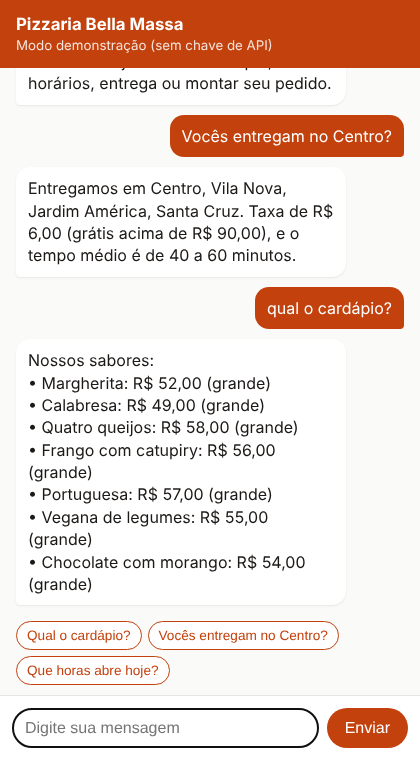

# Chatbot de atendimento com IA para pequenos negócios

Atendente virtual para o site de um pequeno negócio (o exemplo é uma pizzaria). Ele responde sobre cardápio, horários, entrega e pagamento, e ajuda o cliente a montar o pedido com o valor total. Usa só as informações cadastradas em `negocio.json`, então não inventa preços nem promoções.



**Problema que resolve:** pequenos negócios perdem vendas porque demoram para responder perguntas repetidas. O bot atende na hora, 24 horas por dia.

## Como usar

Requer Python 3.10 ou mais novo.

```bash
python -m venv .venv
source .venv/bin/activate        # no Windows: .venv\Scripts\activate
pip install -r requirements.txt

uvicorn app:app --reload
```

Abra http://localhost:8000.

- **Sem configurar nada:** roda em modo demonstração, respondendo por palavras-chave. Serve para mostrar a interface.
- **Com IA:** escolha uma das IAs abaixo e reinicie o servidor.

## Escolher a IA

O chatbot funciona com quatro fornecedores. A escolha é feita pela variável `CHATBOT_PROVEDOR`, sem mudar o código:

| `CHATBOT_PROVEDOR` | Chave | Modelo padrão | Custo |
|---|---|---|---|
| `claude` | `ANTHROPIC_API_KEY`, criada em https://platform.claude.com | `claude-opus-5-5` | Pago por uso |
| `gemini` | `GEMINI_API_KEY`, criada no Google AI Studio | `gemini-flash-latest` | Tem plano gratuito com limites |
| `groq` | `GROQ_API_KEY`, criada em https://console.groq.com | `llama-3.3-70b-versatile` | Tem plano gratuito com limites |
| `ollama` | Nenhuma: roda no seu computador | `llama3.2` | Grátis |

Se `CHATBOT_PROVEDOR` não for definida, o bot usa o Claude quando `ANTHROPIC_API_KEY` existe, e o modo demonstração quando não existe. Para trocar o modelo de qualquer fornecedor, defina `CHATBOT_MODELO`.

Exemplo com o Gemini no Windows (PowerShell):

```powershell
$env:CHATBOT_PROVEDOR="gemini"
$env:GEMINI_API_KEY="sua-chave"
uvicorn app:app --reload
```

No Linux ou Mac, troque `$env:NOME="valor"` por `export NOME=valor`.

Para usar o Ollama, instale em https://ollama.com, baixe o modelo com `ollama pull llama3.2`, defina `CHATBOT_PROVEDOR=ollama` e suba o servidor. O Ollama precisa ficar rodando enquanto o chat estiver em uso: deixe o aplicativo aberto ou rode `ollama serve` em outro terminal. Se você baixou outro modelo, use o nome que aparece em `ollama list` na variável `CHATBOT_MODELO`.

Ao subir, o terminal mostra qual IA está em uso (`Chatbot usando: gemini`). Se faltar a chave, o servidor nem sobe e diz qual variável definir. Erros da IA, como chave inválida ou falta de créditos, aparecem no terminal do `uvicorn`.

Gemini, Groq e Ollama seguem o formato de API da OpenAI. Para adicionar outro serviço compatível, basta incluir uma linha em `COMPATIVEIS_OPENAI`, no `chatbot.py`.

## Adaptar para outro cliente

Edite só o `negocio.json` (nome, endereço, horários, cardápio, regras). O comportamento do atendente está em `montar_instrucoes`, no arquivo `chatbot.py`.

## Estrutura

| Arquivo | O que faz |
|---|---|
| `chatbot.py` | Monta as instruções a partir do negócio, valida a conversa, escolhe a IA e faz a chamada |
| `app.py` | API em FastAPI (`/api/chat`, `/api/status`) e serve a página |
| `static/index.html` | Interface do chat, sem framework |
| `negocio.json` | Dados do negócio |

## Testes

Os testes não chamam a API de verdade:

```bash
pytest
```

## Tecnologias

Python, FastAPI, API do Claude (Anthropic), SDK da OpenAI (para Gemini, Groq e Ollama), HTML/CSS/JS.

## Ideias de evolução

- Ligar ao WhatsApp pela API oficial (Meta Cloud API).
- Salvar os pedidos num banco de dados e avisar a cozinha.
- Painel em Angular para o dono editar o cardápio.

## Autor

Feito por **Luis Lopo**, desenvolvedor Python, Java e TypeScript. Faço automações, relatórios e chatbots sob medida para pequenos negócios. Veja os outros projetos no meu perfil do GitHub.